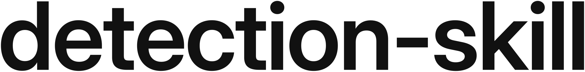

<p align="center">
  <picture>
    <source media="(prefers-color-scheme: dark)" srcset="brand/app-icon-dark.png">
    
  </picture>
</p>

<p align="center">
  <picture>
    <source media="(prefers-color-scheme: dark)" srcset="brand/logo/detection-skill-wordmark-white.svg">
    
  </picture>
</p>

<p align="center"><b>Faces, text and objects, as boxes in time</b></p>


Faces, text and objects in video frames, as measured boxes in time, for the [AI Video Production OS](https://github.com/kajisho5/AI-video-production-OS) (department 認識 / Recognition). Each box carries the frame time, the box in pixels and normalized, a score, and the engine, model and model-file sha256 that produced it. Boxes over time become redact-ready rectangles for [ffmpeg-skill](https://github.com/kajisho5/ffmpeg-skill) `redact`. It also measures shot boundaries over every frame (cuts and dissolves) and turns face tracks into a reframing path (a crop window per time for 9:16, 1:1, 4:5).

Local, offline, CPU first ([ADR-001](docs/decisions.md)): faces with [YuNet](https://github.com/opencv/opencv_zoo/tree/main/models/face_detection_yunet) (MIT) through OpenCV, text with [Tesseract 5](https://github.com/tesseract-ocr/tesseract) and [tessdata_best](https://github.com/tesseract-ocr/tessdata_best) `jpn` / `jpn_vert` / `eng` (Apache-2.0), objects with [YOLOX](https://github.com/Megvii-BaseDetection/YOLOX) (Apache-2.0) through ONNX Runtime, shots with [PySceneDetect](https://github.com/Breakthrough/PySceneDetect) (BSD-3-Clause; [TransNetV2](https://github.com/soCzech/TransNetV2), MIT, optional, [ADR-003](docs/decisions.md)). Two optional second engines run only when asked for with `--engine` ([ADR-008](docs/decisions.md)): [PP-OCRv6](https://huggingface.co/PaddlePaddle/PP-OCRv6_medium_rec) (Apache-2.0) for text and [RF-DETR](https://github.com/roboflow/rf-detr) Small / Medium (Apache-2.0) for objects, both as ONNX files through ONNX Runtime. Every engine is optional. Frames of a video come from ffmpeg-skill `look` and `scenes`; this skill never decodes video and never downloads anything. A face box is never an identity.

```bash
pip install -e '.[all]'                       # the skill + OpenCV + ONNX Runtime (faces and objects)
export DETECTION_MODELS_DIR=~/models/detection # YuNet and YOLOX .onnx files (see below)
detection doctor                              # what is missing, and how to get it
detection faces talk.mp4 --every 0.5 -o faces.json
detection tracks faces.json -o tracks.json    # redact rectangles per face track
detection text slide.png -o text.json         # jpn+eng by default
detection objects hall.mp4 --every 2 --classes person,laptop -o objects.json
detection text slide.png --engine ppocrv6 -o text.json        # optional: PP-OCRv6 (files below)
detection objects hall.mp4 --engine rfdetr --every 2 -o objects.json   # optional: RF-DETR S/M (export below)
detection shots talk.mp4 -o shots.json        # every frame: cuts and dissolves
detection reframe tracks.json --aspect 9:16 --shots shots.json -o reframe.json
detection rank faces.json -o rank.json --top 5  # thumbnail candidates (faces --attributes): eyes open, sharp
detection pii text.json -o pii.json            # patient ids, dates of birth, ... to confirm before publishing
detection speakers --camera camA_tracks.json --camera camB_tracks.json -o speakers.json   # multicam switch list
```

`tracks`, `reframe`, `speakers`, `pii`, `rank` and `check` need only the Python standard library (`pip install -e .`, Python >= 3.9).

## Install, per engine

| Engine | Install | Model files (a directory you point to; never downloaded by the skill) |
|---|---|---|
| Faces: YuNet | `pip install -e '.[faces]'` (opencv-python-headless) | `face_detection_yunet_2026may.onnx` from [OpenCV Zoo](https://github.com/opencv/opencv_zoo/tree/main/models/face_detection_yunet), **MIT**. A Git LFS file: download it from the GitHub page, or `git lfs pull` in a clone. Put it in `$DETECTION_MODELS_DIR` |
| Text: Tesseract 5 | the `tesseract` binary: `apt install tesseract-ocr tesseract-ocr-jpn tesseract-ocr-jpn-vert`, `brew install tesseract tesseract-lang`, or `choco install tesseract` | `jpn.traineddata`, `jpn_vert.traineddata`, `eng.traineddata` from [tessdata_best](https://github.com/tesseract-ocr/tessdata_best), **Apache-2.0**, in a directory set as `--tessdata-dir` / `$DETECTION_TESSDATA_DIR`. Without it, Tesseract's own data is used (on Ubuntu, the `tessdata` variant from apt) and every result says which variant it was |
| Objects: YOLOX | `pip install -e '.[objects]'` (onnxruntime, opencv-python-headless) | a YOLOX ONNX file from the [YOLOX releases](https://github.com/Megvii-BaseDetection/YOLOX/releases) (e.g. `yolox_s.onnx`, or `yolox_nano.onnx` for speed), **Apache-2.0**, in `$DETECTION_MODELS_DIR`. COCO's 80 classes |
| Text, optional: PP-OCRv6 (`text --engine ppocrv6`) | `pip install -e '.[objects]'` (onnxruntime, opencv-python-headless); no new package | three files in `$DETECTION_MODELS_DIR`, **Apache-2.0**: the official ONNX exports of [PP-OCRv6_medium_det](https://huggingface.co/PaddlePaddle/PP-OCRv6_medium_det_onnx) and [PP-OCRv6_medium_rec](https://huggingface.co/PaddlePaddle/PP-OCRv6_medium_rec_onnx) (both named `inference.onnx` there) and the recognizer's `inference.yml` (its character dictionary), saved as `PP-OCRv6_medium_det.onnx`, `PP-OCRv6_medium_rec.onnx`, `PP-OCRv6_medium_rec.yml` (the commands below; the `small` tier under the same names also works). About 139 MB |
| Objects, optional: RF-DETR (`objects --engine rfdetr`) | `pip install -e '.[objects]'`; no new package (no PyTorch) | no ONNX file is published: export the official COCO weights once with the `rfdetr` package (PyTorch is needed for the export only, in any environment with Python 3.10+) and save `rfdetr-small.onnx` or `rfdetr-medium.onnx` in `$DETECTION_MODELS_DIR` (the commands below). **Apache-2.0** (RF-DETR Small and Medium, the two file names the skill prefers and records as Apache-2.0; Nano and Large are Apache-2.0 too, Atto, Femto, Pico, XL and 2XL are under the Roboflow PML 1.0. Any other `rfdetr*.onnx`, picked when neither of the two is there or named with `--model`, runs with `model_license: unknown (not checked)` and a warning) |
| Shots: PySceneDetect | `pip install -e '.[shots]'` (scenedetect `>=0.6.7 <0.7`, opencv-python-headless) | none. Optional `--engine transnetv2`: an ONNX export of [TransNetV2](https://github.com/soCzech/TransNetV2) (code and weights **MIT**) as `transnetv2.onnx` in `$DETECTION_MODELS_DIR`, run by ONNX Runtime (`[objects]`); `doctor` reports it `MISSING` (optional) until then |
| Frames of a video | [ffmpeg-skill](https://github.com/kajisho5/ffmpeg-skill) 2.x or 3.x and FFmpeg (3.x needs Python 3.10+ and FFmpeg 6.1+) | `git clone https://github.com/kajisho5/ffmpeg-skill ~/.claude/skills/ffmpeg-skill`, or `--ffmpeg-skill` / `$DETECTION_FFMPEG_SKILL_DIR` |

Model files are identified by sha256, measured on every run and written into every result. The skill knows these files (`detection contract --json`, `engines.known_model_sha256`):

| File | sha256 |
|---|---|
| `face_detection_yunet_2026may.onnx` | `ebafce4e3c118d6554634be5c27ab333b4c047a9a8c3faf1d7cf93101c22f0f0` |
| `yolox_nano.onnx` (YOLOX release 0.1.1rc0) | `c789161ed43c8269fcd4e67c67eeeb4e80c622da2eb296a20bc6007bd18a0b7d` |
| tessdata_best `jpn.traineddata` | `36bdf9ac823f5911e624c30d0553e890b8abc7c31a65b3ef14da943658c40b79` |
| tessdata_best `jpn_vert.traineddata` | `1258be6eb2a9851f18043234ad18cca13ed32690bfff62b335c898bbea371548` |
| tessdata_best `eng.traineddata` | `8280aed0782fe27257a68ea10fe7ef324ca0f8d85bd2fd145d1c2b560bcb66ba` |
| `PP-OCRv6_medium_det.onnx` (`PaddlePaddle/PP-OCRv6_medium_det_onnx` `inference.onnx`, revision `6132380`) | `eb13b44b25bb36f89528b68720af8a61d9cf381176107f465db1757b65d086e1` |
| `PP-OCRv6_medium_rec.onnx` (`PaddlePaddle/PP-OCRv6_medium_rec_onnx` `inference.onnx`, revision `50c7eac`) | `9c09abf0957f7968c7586464b7397b84ad2387a0497a351af40e9acc71b673ba` |
| `PP-OCRv6_medium_rec.yml` (the same repository's `inference.yml`) | `991b700facf5b50a7de193468207d5f4255b538dde0d312ae3b7c7a9b6873129` |
| `PP-OCRv6_small_det.onnx` / `_small_rec.onnx` / `_small_rec.yml` | `d73e0058...9410e` / `5435fd74...24634` / `ab078671...c77d1` (in `engines.known_model_sha256`) |

The PP-OCRv6 files, pinned to the revisions above (about 62 MB + 77 MB; the skill itself never downloads; `detection doctor` prints the same commands):

```bash
cd "${DETECTION_MODELS_DIR:?set DETECTION_MODELS_DIR to the models directory}" &&
  curl -fL -o PP-OCRv6_medium_det.onnx https://huggingface.co/PaddlePaddle/PP-OCRv6_medium_det_onnx/resolve/61323801669c338b7891481ec7bac61ce31b576a/inference.onnx &&
  curl -fL -o PP-OCRv6_medium_rec.onnx https://huggingface.co/PaddlePaddle/PP-OCRv6_medium_rec_onnx/resolve/50c7eacafc52fa7bcf4194e8cd08e46f8558504b/inference.onnx &&
  curl -fL -o PP-OCRv6_medium_rec.yml https://huggingface.co/PaddlePaddle/PP-OCRv6_medium_rec_onnx/resolve/50c7eacafc52fa7bcf4194e8cd08e46f8558504b/inference.yml
```

One `&&` chain: if the `cd` fails (the variable unset or the directory missing), nothing is downloaded into the current directory.

An RF-DETR export, once, in any environment with Python 3.10+ (it installs PyTorch there; this skill never imports it). `RFDETRSmall()` fetches the official COCO weights, `export()` writes `rfdetr-small.onnx` (`RFDETRMedium` writes `rfdetr-medium.onnx`):

```bash
test -d "${DETECTION_MODELS_DIR:?set DETECTION_MODELS_DIR to the models directory}" &&
  pip install "rfdetr[onnx]==1.12.0" &&
  python -c "from rfdetr import RFDETRSmall; RFDETRSmall().export(output_dir='rfdetr-export')" &&
  cp rfdetr-export/rfdetr-small.onnx "${DETECTION_MODELS_DIR:?set DETECTION_MODELS_DIR to the models directory}/"
```

An export has no fixed sha256 (it is made by you), so it runs with its measured sha256 recorded and a warning.

Another file (for example `yolox_s.onnx`) still runs: its measured sha256 is recorded and the result carries a warning that the skill has not seen that file before. `doctor` reports `MISSING` with the source for each missing file and `INCOMPLETE` for a Git LFS pointer.

## Commands

| Command | What it does |
|---|---|
| `faces <video\|image> [--every S \| --at t,... \| --scenes] [--min-score 0.6] [--models-dir DIR] [--model FILE] [--attributes] [-o det.json]` | Face boxes with five landmarks ([`detection-skill/detections@1`](docs/detections.md)); `--attributes` adds size, pose, sharpness, mouth contrast and eyes open |
| `text <video\|image> [...] [--engine tesseract\|ppocrv6] [--lang jpn+eng] [--vertical] [--psm N] [--level line\|word] [--tessdata-dir DIR] [--models-dir DIR]` | Text lines (or words) with their OCR text; `--engine ppocrv6` (optional) reads lines with PP-OCRv6 and takes none of the Tesseract options |
| `objects <video\|image> [...] [--engine yolox\|rfdetr] [--classes person,...] [--min-score 0.3]` | Object boxes with COCO class names; `--engine rfdetr` (optional) uses an RF-DETR Small / Medium export |
| `tracks <det.json> -o tracks.json [--min-iou 0.3] [--max-shift 1.0] [--max-gap S] [--pad 0.15] [--extend S] [--window S] [--min-hits 1]` | Boxes linked over time by IoU into track ids, with even-pixel redact rectangles per span (a heuristic, [docs/detections.md](docs/detections.md#tracks-a-heuristic)) |
| `shots <video> [--engine pyscenedetect\|transnetv2] [--threshold X] [--min-shot-frames 15] [--width 320] [--max-frames 20000] [-o shots.json]` | Shot boundaries over every frame: each shot's start/end in frames and seconds, cut / gradual, a score, the engine ([`detection-skill/shots@1`](docs/detections.md#shots)) |
| `reframe <face-tracks.json> -o reframe.json [--aspect 9:16] [--shots shots.json] [--objects object-tracks.json] [--dead-zone 0.1] [--max-speed 0.6]` | A crop window per sample time following the subject, jumping only at a shot boundary, plus one window per shot (a heuristic, [`detection-skill/reframe@1`](docs/detections.md#reframe-a-heuristic)) |
| `speakers --camera <cam0-tracks.json> --camera <cam1-tracks.json> -o speakers.json [--offsets 0,S] [--turns turns.json] [--turns-offset S] [--window 0.6] [--min-activity 0.02] [--min-shot 1.0]` | Who speaks in each time range and which camera shows them best, as a switch list for ffmpeg-skill `multicam` (a heuristic, [`detection-skill/speakers@1`](docs/detections.md#speakers-a-heuristic)) |
| `pii <text-det.json> -o pii.json [--faces face-det.json] [--locale intl,en-US,en-GB,ja-JP] [--pad 0.1]` | Names, patient ids, dates of birth, phone numbers and addresses in OCR text (patterns per locale, `intl` by default) and faces, as redact-ready regions, each a proposal to confirm ([`detection-skill/pii@1`](docs/detections.md#personal-data-patterns-every-region-a-proposal)) |
| `rank <face-det.json> -o rank.json [--top N] [--all-faces]` | Frames ranked for a thumbnail or a take by their faces' eyes open, sharpness, frontal angle and size (a heuristic, [`detection-skill/face-rank@1`](docs/detections.md#face-rank-a-heuristic)) |
| `check <det.json\|tracks.json\|shots.json\|reframe.json\|speakers.json\|pii.json\|rank.json>` | Validate a detections, tracks, shots, reframe, speakers, pii or rank document |
| `contract --json` | Machine-readable contract in the OS registry's shape |
| `doctor --json [--models-dir DIR] [--tessdata-dir DIR] [--ffmpeg-skill DIR]` | Python, ffmpeg-skill, OpenCV, ONNX Runtime, the model files, Tesseract and its languages; `MISSING` entries carry install lines |

Common options: `--max-frames 2000` (refuses a bigger sampling plan), `--timeout 3600` (seconds for the engine; the worker process group is killed past it), `--ffmpeg-skill DIR`, `--overwrite`, `--json`. A video without a sampling option is sampled once a second. Every command prints one JSON document with `--json`. Exit codes: 0 ok, 2 invalid input or arguments, 3 engine / model file / tessdata / ffmpeg-skill missing, 4 the engine or frame extraction failed or timed out. Outputs never overwrite an existing file without `--overwrite`, and `-o` equal to an input is refused.

## How it works

- **Frames.** For a video: ffmpeg-skill `probe` (duration, size, rotation), `scenes` for `--scenes`, then `look --at T ... --no-timecode --width <source width> --json`, which writes PNG frames into a private temporary directory (deleted afterwards). An image is its own single frame.
- **Engines.** The engine runs in a worker subprocess (`python -m detection_skill.engines.worker`) in its own process group, killed on `--timeout`. Model files are found and hashed before any frame is made, so a missing model fails fast with exit 3.
- **Boxes.** Engine boxes are scaled from the extracted frame to the source size, clipped to the frame, and written with `box_norm`, the score and the provenance. The document is validated before it is returned or written.
- **Shots.** Every frame through `look --at` (frame k at its time rounded down to the millisecond, 320 px wide), PySceneDetect's ContentDetector and AdaptiveDetector for cuts, a blend test for dissolves and fades ([ADR-003](docs/decisions.md)).
- **Reframe.** Per shot, the face track with the most presence is the subject; the window follows its centre with a dead zone and a speed limit and jumps only at a shot boundary ([ADR-004](docs/decisions.md)).
- **Speakers.** Mouth motion (the spread of each face's mouth contrast over 0.6 s) says who speaks; view quality (size, frontal angle, sharpness) picks the camera; with diarization-skill turns, each speaker is matched to a face and the switch follows the turns ([ADR-005](docs/decisions.md)).
- **Personal data.** OCR lines checked against keyword and format patterns per locale (`intl` by default; `en-US`, `en-GB`, `ja-JP` opt-in); each hit is the whole line's box as a redact rectangle with its reason, always `CONFIRM`, never removed here ([ADR-006](docs/decisions.md)).
- **Rank.** Each face's eyes open (edge directions in the eye regions), sharpness, frontal angle and size, weighted into a score; frames best first ([ADR-007](docs/decisions.md)).
- **Optional engines** ([ADR-008](docs/decisions.md)). PP-OCRv6 follows PaddleOCR's general OCR pipeline: the DB text detector on the frame (short side at least 64 px, sides rounded to 32), boxes grown by PaddleOCR's unclip, each line cut out and read by the CTC recognizer (height 48); a detection is the line's axis-aligned box, its text and the recognition score, `lang: multi`. RF-DETR follows rfdetr's ONNX reference: the frame resized to the export's square input, a sigmoid per class, the best query/class pairs, COCO's sparse category ids mapped to the same 80 names YOLOX uses, no NMS. Neither changes a default, and neither needs a package beyond `[objects]`.
- **Tracks.** Greedy IoU linking between consecutive samples (with a centre-distance fallback for motion faster than the sampling); redact rectangles are the padded union of a track's boxes, snapped to even pixels, extended by one sampling step on each side. Documented as a heuristic, not identity.

## Measured here

On the fixtures in `tests/` (2026-10-30; shots and reframe 2026-11-06; speakers, pii and rank 2026-11-06; CPU, this repository's tests):

| What | Result |
|---|---|
| YuNet 2026may, 5 faces about 23 px to 276 px wide in one 1920x1080 frame | recall 5/5, precision 5/5 at IoU 0.5 (IoU 0.76-0.90 against hand-drawn boxes); the portrait alone: 1 face, IoU 0.94, five landmarks in order |
| YuNet on a face moving 60 px/s, sampled every 0.2 s through ffmpeg-skill look | 20/20 frames with the face, 1 track |
| YOLOX-Nano: person, cat, cup in three photos | 3/3 found at IoU >= 0.5 (0.97, 0.89, 0.87) |
| PySceneDetect 0.6.7.1, 225-frame fixture (six lavfi sources, 3 hard cuts, 2 cross-dissolves of 20 and 25 frames) | every hard cut on its frame (50, 120, 185), no extra cut; both dissolves found as gradual (middle frame 80 and 148 inside the blends 70-89 and 135-159) |
| Reframe from YuNet tracks + shots: a face walking 105 px/s across 960x540, then a cut | face inside the window in 40/40 sampled frames for 9:16 (302x540), 1:1 and 4:5; fastest move inside a shot 120 px/s against a limit of 181 px/s (9:16) |
| Speakers from YuNet `--attributes` tracks: two cameras (a wide shot of two faces, a close-up of one), speakers alternating every 3 s for 12 s, mouths drawn opening and closing | with turns: the switch list is exactly the turns (`0-3:0, 3-6:1, 6-9:0, 9-12:1`); mouth motion alone: every switch within 0.12 s of the truth, the close-up chosen for its speaker |
| `pii` on rendered slides read by Tesseract | `Patient ID: MRN 00482913` + `DOB: 1956-03-14`: exactly those two lines (intl); a results slide (publication date, statistics): none; 患者ID + 生年月日 (和暦) with `--locale ja-JP`: both |
| `rank` from YuNet `--attributes`: the portrait with eyes open, the same face with both eyes painted closed, and open but blurred, in a 5 s video sampled every 0.5 s | the four sharp open frames rank first; `eyes_open` 0.99-1.00 open against 0.30-0.35 closed; the blurred frames' sharpness below every sharp frame's |
| PP-OCRv6 medium (official ONNX exports, onnxruntime 1.31.1), rendered 1280x720 slides, 4 lines each (DejaVu Sans / Noto Sans CJK, 44 px); 2026-11-12, manual `heavy-tests.yml` | English CER 0.000, Japanese CER 0.000 (106 / 54 chars), 4/4 lines each, line-box IoU 0.72-0.83 (en) / 0.92-0.95 (ja), about 2.2 s per slide including model load |
| RF-DETR Small (exported with rfdetr 1.12.0, torch 2.15.0+cpu; 121,980,503 bytes): person, cat, cup in the three photos; the cat and the cup pasted at known places in a 1280x720 frame | 3/3 at IoU 0.97, 0.97, 0.98 (scores 0.975, 0.960, 0.942); in the wide frame IoU 0.95 (cat) and 0.88 (cup); no object on a plain gray frame; about 1.05 s per image including model load |
| Tesseract 5.3.4, rendered slide text (Noto Sans CJK, 44 px) | Japanese CER 0.019 (apt `tessdata`) / 0.057 (`tessdata_best`); English CER 0.000 with both; vertical Japanese (`jpn_vert`) CER 0.000 |

These are small synthetic fixtures that prove the plumbing and give a floor, not a benchmark. Real event footage (motion blur, small faces, low light, stylised slide fonts) will do worse; measure on your own material before relying on it. On these fixtures `tessdata_best` was not better than apt's `tessdata` for Japanese (it misread 第二章), so the ADR's follow-up (a Japanese CER comparison on real slides, and RapidOCR) stays open.

## Tests

```bash
python -m unittest discover -s tests -v
```

Unit tests inject a test-only engine (`tests/fake_engine.py`, never registered) and a fake ffmpeg-skill (`tests/fake_ffmpeg_skill`, the real tools' JSON shapes, PNG frames written with the standard library), so they run anywhere without engines, models or FFmpeg. They cover the schemas and their validators, sampling, scaling and clipping, the worker and its timeout kill, tracks, shots (frame times, contiguous shots, the blend and TransNetV2 arithmetic), reframe, the CLI, doctor and the contract. The optional PP-OCRv6 and RF-DETR engines are tested without their real model files: the dictionary reader, the resize rules and CTC decoding everywhere; DB post-processing, line crops and RF-DETR decoding with stub sessions; and the whole engine, worker and onnxruntime included, with tiny synthetic ONNX models that `tests/tiny_onnx.py` writes with the standard library (these need numpy, OpenCV and ONNX Runtime). The real files run in `tests/test_real_models.py`: PP-OCRv6 medium on rendered English and Japanese slides (CER, line boxes), RF-DETR Small on the three photos and on two of them pasted at known places in a 1280x720 frame (IoU), YuNet on the portrait (box, landmarks); it skips without the files and fails instead with `DETECTION_REQUIRE_REAL_MODELS=1`. The manual workflow `.github/workflows/heavy-tests.yml` (`gh workflow run heavy-tests.yml --ref <branch>`) runs it: one job exports RF-DETR Small with the commands `doctor` prints (PyTorch in that job only), the other runs `doctor`'s PP-OCRv6 download commands, fetches YuNet, checks every sha256 and runs the tests without PyTorch. Tests that need more skip with the reason: frames through a real ffmpeg-skill checkout (`FFMPEG_SKILL_DIR` or `../ffmpeg-skill`) and FFmpeg; the OS registry conformance checks (`AI_VIDEO_PRODUCTION_OS_DIR` or `../AI-video-production-OS`); the real engines (`DETECTION_MODELS_DIR` with the YuNet / YOLOX files and the Python packages; `scenedetect` for shots; `tesseract` with `jpn`, `jpn_vert`, `eng`, plus Pillow and a Japanese font, `DETECTION_TEST_FONT`, to render the OCR fixture). CER limits: `DETECTION_CER_JA` (default 0.10), `DETECTION_CER_EN` (default 0.05). CI's integration job installs everything (the two model files are fetched by the job and checked against the sha256 above) and fails if any test skips, except the PP-OCRv6 and RF-DETR real-model tests (their skip reason starts `real model, heavy-tests.yml only:`).

Fixture images: `tests/fixtures/astronaut.jpg` (NASA portrait of Eileen Collins, public domain), `chelsea.jpg` and `coffee.jpg` (CC0), as shipped in scikit-image's `data` module.

## License

The code is MIT (see `LICENSE`). Model files are not part of this repository and keep their own licences: YuNet (MIT), Tesseract and tessdata (Apache-2.0), YOLOX (Apache-2.0), TransNetV2 (MIT), PP-OCRv6 (Apache-2.0), RF-DETR (Nano, Small, Medium and Large are Apache-2.0; the skill looks for Small and Medium; Atto, Femto, Pico, XL and 2XL are under the Roboflow PML 1.0). PySceneDetect is BSD-3-Clause.
